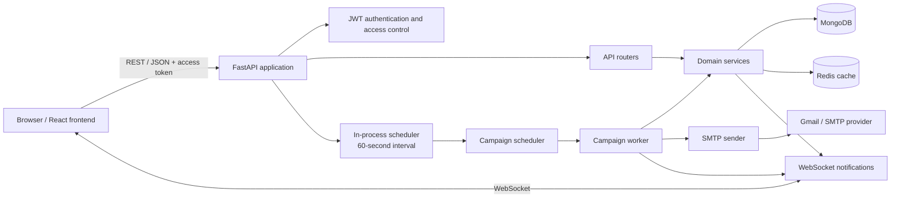
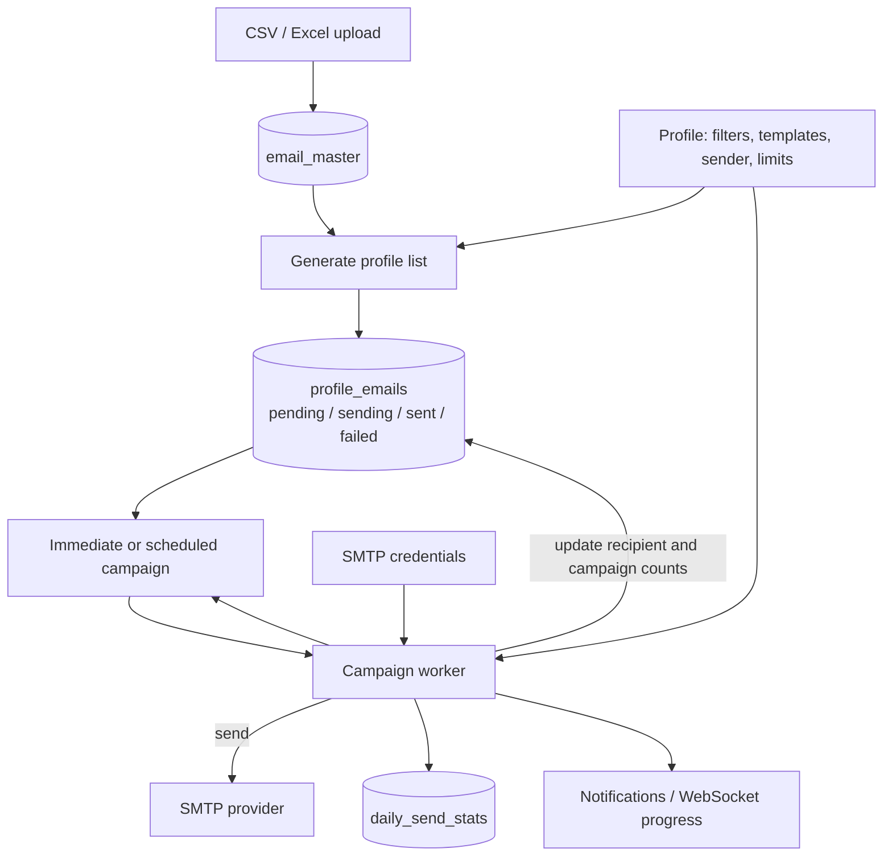

# Project Architecture

## Overview

This project is an internal email marketing platform. The React frontend uses
the FastAPI backend for authentication, lead management, profile configuration,
campaign execution, reporting, and notifications. MongoDB stores application
data. Campaign messages are sent by the backend campaign worker through the
configured SMTP account.



## Runtime and layers

1. **Application startup** — `main.py` creates the FastAPI application,
   installs CORS, request/audit logging and exception handlers, and registers
   the API routers.
2. **Infrastructure startup** — the application lifespan connects to MongoDB
   and Redis, creates MongoDB indexes, applies the admin access-level migration,
   and starts the internal scheduled-campaign loop. Connections and the loop
   are closed on shutdown.
3. **Request handling** — routers validate HTTP inputs and resolve the current
   user's scope. Domain services apply business rules and read/write MongoDB.
   Pydantic schemas define request and response shapes.
4. **Shared infrastructure** — `app/core` contains configuration, JWT and
   authorization dependencies, exceptions, and rate limiting. `app/database`
   contains database connections, indexes, and migrations. `app/utils`
   contains shared serialization, validation, personalization, and pagination.

The common request path is:

```text
Browser -> FastAPI middleware/dependencies -> router -> domain service
        -> MongoDB / external service -> response envelope
```

Protected API calls use JWT access tokens. Employee and admin context helpers
scope reads and writes to the caller's permitted employee records. The API
returns a common response shape; validation and unhandled errors are formatted
by the registered exception handlers.

## Main domain modules

| Module | Responsibility |
|---|---|
| `app/auth` | Login, refresh, logout, and token issuance |
| `app/users`, `app/employees` | User identities, employee records, roles, and employee scope |
| `app/email_accounts` | SMTP account configuration, encrypted credentials, send accounting |
| `app/email_master` | Global imported lead pool, filtering, duplicate and usage tracking |
| `app/profiles` | Employee-owned sending configuration, filters, templates, attachments, and SMTP account selection |
| `app/profile_emails` | Per-profile working copy of leads and per-recipient send state |
| `app/campaigns` | Campaign creation, status changes, listing, and scheduled-run coordination |
| `app/campaign_engine` | Campaign execution loop and SMTP message construction/sending |
| `app/notifications` | Persistent notifications and WebSocket delivery |
| `app/dashboard`, `app/reports`, `app/logs` | Analytics, exports, and activity history |
| `app/templates`, `app/settings`, `app/options` | Reusable templates and supporting configuration/lookups |

## Lead-to-campaign data flow



### Lead and profile records

- Uploaded leads are stored in the shared `email_master` collection.
- A profile holds filters, sender account, templates, sending options, and
  optional attachments.
- Generating a profile list copies matching lead fields into
  `profile_emails`. Each working row references its profile and, when
  available, its source `masterEmailId`; the master record is not the send
  queue.
- A profile-email row has a `mailType` of `draft` or `reminder` and a
  `sendStatus`: `pending`, `sending`, `sent`, `failed`, or `skipped`.
- A campaign points to a profile and selects a mail type. Campaign records
  track overall totals, sent/failed/pending counters, scheduling data, and an
  error message when applicable.

## Campaign execution

### Immediate campaign

1. `POST /campaigns/start` validates the active profile, pending emails, and
   absence of a conflicting active campaign of the same mail type.
2. The service creates a `pending` campaign, snapshots relevant profile
   settings, associates the pending profile-email rows with the campaign, and
   sends the campaign ID to a FastAPI background task.
3. The worker claims a lock so only one worker executes the campaign at a
   time. It loads the profile and SMTP credentials, resolves templates, and
   transitions the campaign to `running`.
4. The worker fetches recipients in batches, claims each row by changing it
   from `pending` to `sending`, personalizes the selected template, and sends
   through SMTP.
5. On success it marks the row `sent`, updates campaign and account counters,
   records employee daily-send statistics, and pushes progress events.
6. When the queue is exhausted, the campaign is finalized as `completed`.

The sender executes blocking SMTP operations in a thread pool so they do not
block the FastAPI event loop.

### Scheduled and recurring campaign

1. `POST /campaigns/schedule` creates a campaign with status `scheduled` and
   computes its next UTC run time from the requested local time, timezone
   offset, and recurrence settings.
2. The scheduler loop in `main.py` checks for due campaigns every 60 seconds.
   It selects both `scheduled` and `rescheduled` campaigns whose
   `scheduledFor` is due.
3. An atomic status transition moves a due campaign to `processing`, resets
   that run's `executionSent` counter, and increments its execution generation
   to prevent duplicate or stale runs.
4. The scheduler starts the same campaign worker used by immediate campaigns.
5. A successful one-time campaign completes. A successful recurring campaign
   with no pending recipients completes; if recipients remain, the next run
   time is calculated and the status becomes `rescheduled`.
6. The next scheduler tick will pick up that `rescheduled` campaign when its
   next run time is due. Filtering the campaign list with `status=scheduled`
   includes both `scheduled` and `rescheduled` campaigns.

## Campaign states

```text
Immediate:
pending -> running -> completed
                    -> paused -> running (resume)
                    -> failed

Scheduled:
scheduled -> processing -> completed (one-time, or no recipients remain)
                        -> rescheduled (recurring, recipients remain)
                        -> failed
rescheduled -> processing (when next occurrence is due)
processing -> paused -> processing (resume scheduled execution)
```

The `rescheduled` state means the recurring campaign has finished its current
run and has a future `scheduledFor` time. It is not currently sending.

## Limits and failure behavior

- **Campaign daily send limit:** counts successful sends in the current run.
  An immediate campaign with recipients remaining is paused at its configured
  limit. A recurring run ends at the limit and is rescheduled for its next
  occurrence.
- **Recipient-domain cap:** the worker excludes non-Gmail recipient domains
  after five successful sends to that domain for the profile on the current
  UTC day. Gmail recipient domains are exempt from this cap.
- **SMTP send failure:** the attempted recipient is marked failed and the
  campaign is marked failed with the SMTP error in `errorMessage`; the worker
  stops rather than sending to further recipients.
- **Missing profile, credentials, or usable templates:** the campaign is
  failed with a reason and an error notification.
- **Invalid/empty selected template:** that recipient is marked failed and
  counted; the worker continues to the next recipient.
- **Unexpected worker exception:** the exception is logged and the campaign is
  failed. A recipient already marked `sending` when the exception occurred may
  require operational cleanup.
- **WebSocket delivery issue:** progress delivery is best-effort and does not
  stop the send loop.
- **Retry note:** failed profile-email rows can be manually reset to pending
  through the profile-emails retry-failed endpoint. Scheduled `maxRetries` and
  `retryCount` are stored, but the scheduler does not automatically retry a
  failed campaign.

## Persistence and notifications

MongoDB is the system of record. Common collections include `users`,
`employees`, `email_accounts`, `email_master`, `profiles`, `profile_emails`,
`campaigns`, `notifications`, `logs`, and `daily_send_stats`.

Redis is initialized at application startup and is used by the email-master
service for dropdown-option caching. Campaign updates and errors are stored in
MongoDB; the notification service sends user-facing events, while the worker
also pushes live progress over WebSockets.

## Repository map

```text
backend/
  main.py                  FastAPI app, router registration, infrastructure lifecycle
  app/
    core/                  Configuration, auth dependencies, errors, rate limits
    database/              MongoDB, Redis, indexes, migrations
    middleware/            Request/audit logging and exception formatting
    auth/, users/, employees/
    email_accounts/, email_master/, profiles/, profile_emails/
    campaigns/             Campaign APIs, service, and scheduler
    campaign_engine/       Worker and SMTP sender
    notifications/, logs/, dashboard/, reports/
    templates/, settings/, options/, utils/, schemas/
  tests/                   Automated tests


../frontend/
  React/Vite browser client (separate project; not modified by this document)
```

## Current-code note

Some older project documentation describes an n8n-owned email delivery flow.
The active application entry point in `main.py` registers the campaign engine
and the backend SMTP sender described here; consult the running code when
older documentation differs.
